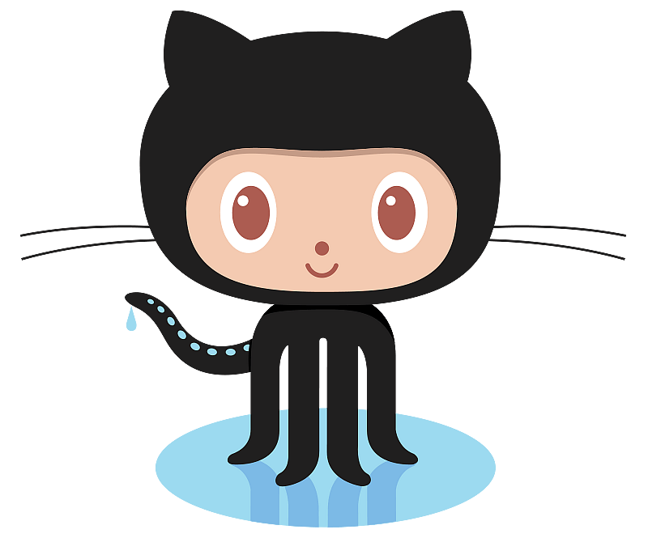

<div align="center">




# Hi, I'm Markzz 

<a href="https://git.io/typing-svg">
  
</a>

**I build lightweight, dependency-free software for Termux, Android, and the terminal.**
<br />
*If it needs a 400 MB runtime, it probably doesn't need to exist.*

<p>
  <a href="https://github.com/Mark44928?tab=followers"></a>
  
  
  <a href="mailto:marklarencecoyoca@gmail.com"></a>
</p>

</div>

---

## `~$ whoami`

```console
mark@termux:~$ whoami
Markzz — systems tinkerer, Termux native, Android root enthusiast.

mark@termux:~$ cat ~/.philosophy
"Small binaries. Zero bloat. Tools that respect your RAM."

mark@termux:~$ uptime
up 2 years — building NoNameOS, Grub Blasters, and whatever scratches the itch.
```

---

## 🚀 Start here

| If you want… | Open |
|---|---|
| a terminal that matches your setup | [Greenit](https://github.com/Mark44928/Greenit) · [Plusafetch](https://github.com/Mark44928/Plusafetch) · [android12-fastfetch](https://github.com/Mark44928/android12-fastfetch) |
| a game for a coffee break | [Grub Blasters](https://github.com/Mark44928/GrubBlastersHTML) · [SnakTUI](https://github.com/Mark44928/SnakTUI) |
| a calculator that stays open | [Plusalator](https://github.com/Mark44928/Plusalator) · [CalculaHTML](https://github.com/Mark44928/CalculaHTML) |
| less bloat on Android | [Easy-Termux-Package-Manager](https://github.com/Mark44928/Easy-Termux-Package-Manager) · [Anti-bloatware for Android TV](https://github.com/Mark44928/Anti-bloatware-list-for-Android-TV-Boxes-and-Sticks-for-rooted) |

<p align="center"><a href="#screens">Screenshots</a> · <a href="#now">Now</a> · <a href="#stack">Tech stack</a> · <a href="#projects">Projects</a> · <a href="#connect">Connect</a></p>

---

<a id="screens"></a>
## 📸 Screenshots

<p align="center"><em>Straight from the repos: games, tools, themes and a tiny OS.</em></p>

<table>
  <tr>
    <td width="50%" align="center">
      <a href="https://github.com/Mark44928/SnakTUI"></a>
      <br><sub><b>SnakTUI</b> — Textual Snake with 11 themes, combos and power-ups</sub>
    </td>
    <td width="50%" align="center">
      <a href="https://github.com/Mark44928/Plusalator"></a>
      <br><sub><b>Plusalator</b> — C++17 calculator REPL: ASCII plots, CSV export, 18 themes</sub>
    </td>
  </tr>
  <tr>
    <td width="50%" align="center">
      <a href="https://github.com/Mark44928/CalculaHTML"></a>
      <br><sub><b>CalculaHTML</b> — PWA calculator: 15 themes, f(x) graph, base chips</sub>
    </td>
    <td width="50%" align="center">
      <a href="https://github.com/Mark44928/Easy-Termux-Package-Manager"></a>
      <br><sub><b>Easy-Termux-Package-Manager</b> — 57-entry Termux package manager, zero dependencies</sub>
    </td>
  </tr>
  <tr>
    <td width="50%" align="center">
      <a href="https://github.com/Mark44928/Plusafetch"></a>
      <br><sub><b>Plusafetch</b> — C++23 Android system fetch — ~23 ms, no subprocess</sub>
    </td>
    <td width="50%" align="center">
      <a href="https://github.com/Mark44928/android12-fastfetch"></a>
      <br><sub><b>android12-fastfetch</b> — Fastfetch config driven by Android properties</sub>
    </td>
  </tr>
  <tr>
    <td width="50%" align="center">
      <a href="https://github.com/Mark44928/Greenit"></a>
      <br><sub><b>Greenit</b> — One palette.json → kitty, ghostty, vim, fish, zellij…</sub>
    </td>
    <td width="50%" align="center">
      <a href="https://github.com/Mark44928/NoNameOS"></a>
      <br><sub><b>NoNameOS</b> — Single-file C++17 OS simulation with a real shell</sub>
    </td>
  </tr>
</table>

<a id="now"></a>
## 📍 Now

- **Plusafetch** — my C++23 take on fastfetch: NDK property service for Android (zero subprocess on the default path, ~23 ms on a Helio P22), `std::jthread` parallel detection, `std::expected` everywhere, no logo, no network. CI green on clang/gcc/AppleClang.
- **pkg-manager v5.3.1** — 57 numbered entries + Back/Exit split everywhere, live ask_name package picker, snapshot-restore path guard against archive extraction attacks, symlink-proof backups, and audit/doctor commands that fail loudly instead of reporting "all clear" on apt errors — plus a not-installed-only install list with a pre-flight batch summary, uninstall's own finder, ESC that cancels everywhere, and a numbered text mode that takes over (with an explanation) if fzf ever breaks.
- **Fresh this week** — Plusalator plots any function in ASCII and exports vars/history to CSV; CalculaHTML converts results to hex/bin/oct in one tap; Grub Blasters has a per-device Motion control; SnakTUI shows live palette swatches in Settings; Plusafetch ships four copy-paste skins.
- NoNameOS gained real `sha256sum`/`stat` commands plus a piped-REPL smoke
  suite, Plusalator gained memory slots, angle units and output radix modes,
  and Android9-audios ships per-file checksums with a verify script.
- **Still** refusing to install a 400 MB runtime.

- 🔭 **Building** — expanding **NoNameOS**, a single-file C++17 OS simulation
- 🌱 **Exploring** — low-level Android internals, TUI design, and game loops
- 🧠 **Belief** — the best dependency is the one you never installed
- 😗 **Fun fact** — I rooted a TV stick and reclaimed **1.9 GB** of storage

---

<a id="stack"></a>
## 🛠️ Tech Stack

<div align="center">


<br><br>


</div>

---

## 📊 GitHub Dashboard

<div align="center">

<a href="https://github.com/Mark44928">
  
  
</a>

<br>


<br /><br />

<a href="https://github.com/Mark44928">
  
</a>

</div>

---

<a id="projects"></a>
## 🚀 Featured Projects

### 🎮 Grub Blasters
**Worms-style turn-based artillery in a single dependency-free HTML file.** 2–4 teams blast each other across procedurally generated, fully destructible terrain with 70 weapons (bazooka to banana bomb), a fuel-limited jetpack, floating islands, CPU opponents, shifting wind, a rising sea, and hot-seat multiplayer.

> No dependencies. No build step. One file, any modern browser, desktop or phone.

[](https://mark44928.github.io/GrubBlastersHTML/)
[](https://github.com/Mark44928/GrubBlastersHTML)

---

### 📦 Easy-Termux-Package-Manager · MIT
**fzf-driven interactive package manager for Termux** — a friendlier face for `pkg`/`apt` without touching the raw commands. 57 menu entries + Exit, 16 themes, live package-info preview panes, automated backup/restore, package pin/hold, a system-audit health score, SHA-256-verified self-update, and a scriptable CLI (`--check-updates`, `--quiet`, `--doctor`) — 184 tests.

[](https://github.com/Mark44928/Easy-Termux-Package-Manager)

---

### 🖥️ NoNameOS · GPL-3.0
**A complete OS simulation in one C++17 file.** Interactive shell, virtual filesystem, built-in utilities, and games — zero external dependencies. Single-file architecture, self-contained complexity, and a genuinely fun way to learn systems concepts.


> *Screenshot from an earlier build — the current version is far more feature-rich.*

[](https://github.com/Mark44928/NoNameOS)

---

### 🐍 SnakTUI · MIT
**A modern, visually stunning Snake game for your terminal** — Python + Textual. Neon gradients, particle bursts, combo multipliers up to x5, power-ups (Speed, Slow, Ghost, Frenzy, Magnet), golden apples, eleven themes, three difficulties, and a persistent local leaderboard, all in pure Unicode blocks.

> Cinematic effects — glow, screen shake, floating score popups — with a layout that adapts to your terminal.

[](https://github.com/Mark44928/SnakTUI)

---

### 🔢 CalculaHTML · MIT
**A feature-rich, visually rich modern HTML calculator** with 15 themes plus a System mode (Tokyo Night, Catppuccin, Gruvbox, Nord, Dracula…), scientific functions, memory registers, a history tape with CSV export, a `?` shortcut overlay, keyboard shortcuts, and full responsiveness — all in a single dependency-free page.

[](https://mark44928.github.io/CalculaHTML/)
[](https://github.com/Mark44928/CalculaHTML)

---

### 🧮 Plusalator · MIT
**Fancy interactive C++17 calculator REPL for Termux** — standard library only, single binary. Qalculate-flavored engine: postfix percent (`%`), right-assoc `^` (`-2^2=-4`), implicit multiplication, user functions with depth-capped recursion, and fuzz-gated so it never crashes. Ghost autosuggest, transient prompt with `⟨ plusa ⟩ ➤` ornament, 18 truecolor palettes, memory slots (`ms`/`mr`/`m+`), angle units (`deg`/`rad`/`grad`), and output radix modes (`mode hex|bin|sci`) — 114 assertions in the test gate.

[](https://github.com/Mark44928/Plusalator)

---

### ⚡ Plusafetch · MIT
**A modular C++23 take on fastfetch for Termux** — fastfetch-style A–Z module registry, zero logo, no network, no exceptions. Android OS/host info from the NDK property service (zero subprocess on the default path), `std::jthread` parallel detection, `std::expected` everywhere, zero-allocation string buffers, single-write output — ~23 ms on a Helio P22. Linux fallback included.

[](https://github.com/Mark44928/plusafetch/actions/workflows/ci.yml)
[](https://github.com/Mark44928/plusafetch)

---

### 🖥️ android12-fastfetch · MIT
**Drop-in fastfetch config for Android 12 and native X11 Termux desktops (XFCE, MATE, LXQt).** Beautiful, consistent system information for your terminal — install, run, done.

[](https://github.com/Mark44928/android12-fastfetch)

---

### 📺 Anti-bloatware for Android TV · MIT
**Surgical ADB commands — plus bundled `debloat.sh` / `debloat-safe.sh` / `restore.sh` — to strip bloatware from rooted Android 9+ TV sticks and boxes.** Up to ~1.9 GB storage and 200 MB+ RAM reclaimed, measured on common sticks and boxes.

[](https://github.com/Mark44928/Anti-bloatware-list-for-Android-TV-Boxes-and-Sticks-for-rooted)

---

### 🔊 Android 9 (Pie) Audios · MIT
**All 217 stock Android 9 system sounds** — ringtones, alarms, notifications, UI sounds — in one portable ~8.3 MB archive, with per-file SHA-256 checksums and a one-command extract-and-verify script. Perfect for custom ROMs and audio projects.

[](https://github.com/Mark44928/Android9-audios)

---

### 🟢 Greenit · MIT
**Green-injected terminal, editor, shell and app theme family (dark + light).** 30 integrations rendered from a single `palette.json` by a tiny stdlib-only Python generator — Termux, Kitty, Alacritty, Ghostty, WezTerm, foot, iTerm2, Windows Terminal, Vim/Neovim, Emacs, Helix, bat, fzf, dircolors, eza/lsd, ripgrep, starship, tmux, zellij, lazygit, git, delta, nano, yazi, btop, fish, powerlevel10k, fastfetch, vivid and less.

[](https://github.com/Mark44928/Greenit)

---

## 🐍 Contribution Snake

<div align="center">

<picture>
  <source media="(prefers-color-scheme: dark)" srcset="https://raw.githubusercontent.com/Mark44928/Mark44928/output/github-snake-dark.svg" />
  <source media="(prefers-color-scheme: light)" srcset="https://raw.githubusercontent.com/Mark44928/Mark44928/output/github-snake.svg" />
  
</picture>

</div>

---

## 💡 Engineering Philosophy

<table>
<tr>
<td width="50%" valign="top">

**⚡ Native first**<br>
Prefer solutions that work directly in Termux and Android — no compatibility layer, no emulator.

**🪶 Lean by design**<br>
Keep dependencies, memory footprint, and setup friction as close to zero as possible.

**🔧 Practical tooling**<br>
Build utilities that solve real problems for real devices, not demos for a blog post.

</td>
<td width="50%" valign="top">

**📖 Readable code**<br>
Straightforward implementations beat clever abstractions. Future-you is a reader too.

**🚫 No redundant tools**<br>
Don't maintain two utilities for the same job unless the second one is clearly better.

**🐛 Reproducible bugs**<br>
Clear steps to reproduce are worth more than a vague bug report — and make fixes faster.

</td>
</tr>
</table>

---

<div align="center">


</div>

---

<a id="connect"></a>
## 🌐 Connect

<div align="center">

[](https://github.com/Mark44928)
[](mailto:marklarencecoyoca@gmail.com)

<br>

*Found something useful? A ⭐ on the repo is the best thank-you.*

</div>


<div align="center">

**Mark44928** · C++ · Termux · Android · Systems Programming

*Building tools that respect your time and your RAM.*

</div>
