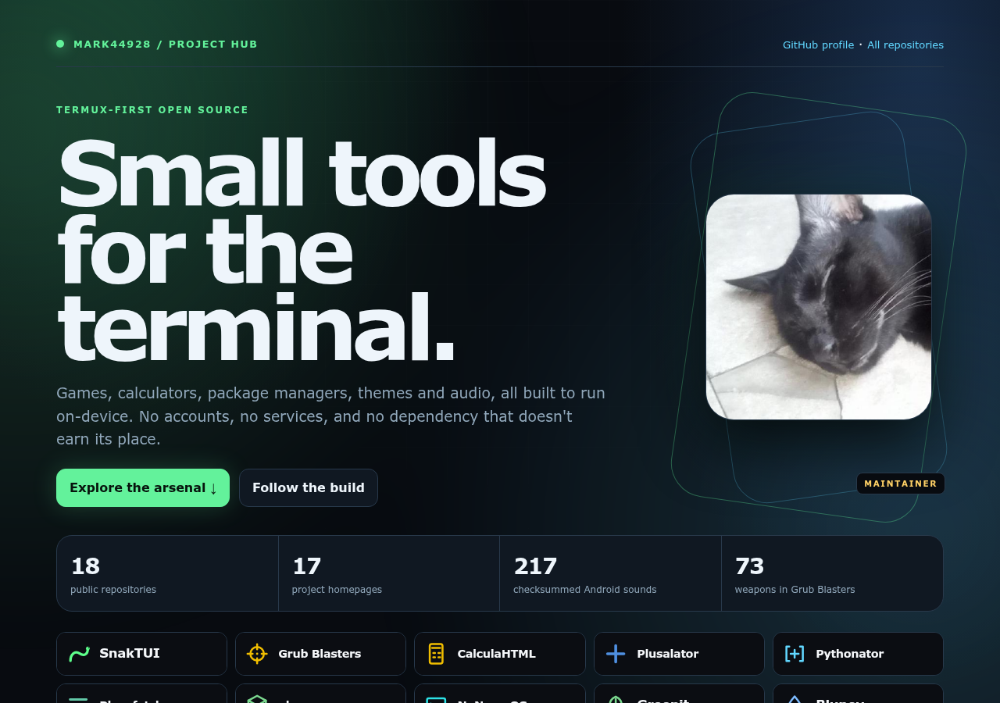
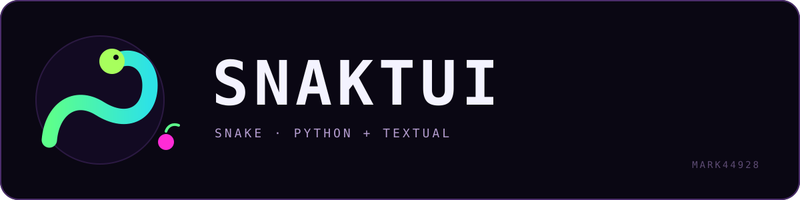
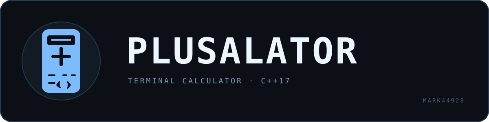
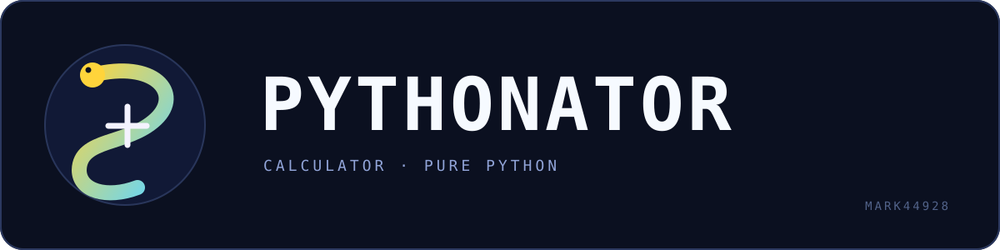
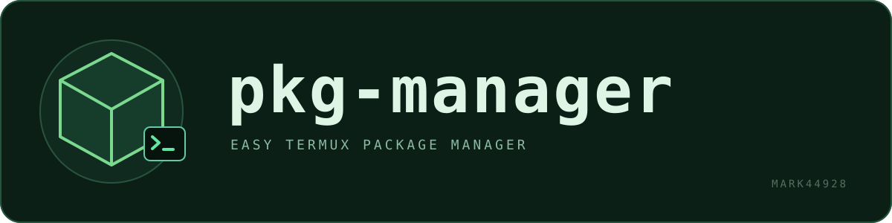
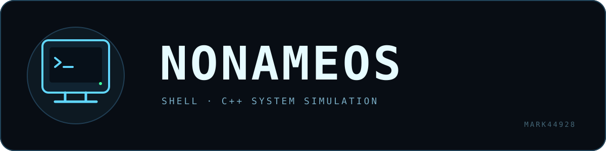

<div align="center">




# Hi, I'm Markzz 

<a href="https://git.io/typing-svg">
  
</a>

**I build lightweight, dependency-free software for Termux, Android, and the terminal.**
<br />
*If it needs a 400 MB runtime, it probably doesn't need to exist.*

**[Open the project hub →](https://mark44928.github.io/Mark44928/)** — every project, one page, no JavaScript.

**Individual homepages:** [SnakTUI](https://mark44928.github.io/SnakTUI/) · [Plusalator](https://mark44928.github.io/Plusalator/) · [Pythonator](https://mark44928.github.io/Pythonator/) · [Solvamath](https://mark44928.github.io/Solvamath/) · [Plusafetch](https://mark44928.github.io/plusafetch/) · [pkg-manager](https://mark44928.github.io/Easy-Termux-Package-Manager/) · [NoNameOS](https://mark44928.github.io/NoNameOS/) · [Greenit](https://mark44928.github.io/Greenit/) · [Bluney](https://mark44928.github.io/Bluney/) · [Yellen](https://mark44928.github.io/Yellen/) · [Fluffless Prompt](https://mark44928.github.io/FlufflessPrompt/) · [Weatui](https://mark44928.github.io/Weatui/) · [LinuBirth](https://mark44928.github.io/LinuBirth/) · [Android9-audios](https://mark44928.github.io/Android9-audios/) · [debloat-android-tv](https://mark44928.github.io/debloat-android-tv/) · [android12-fastfetch](https://mark44928.github.io/android12-fastfetch/)

<p>
  <a href="https://github.com/Mark44928?tab=followers"></a>
  
  
  <a href="mailto:marklarencecoyoca@gmail.com"></a>
</p>

</div>

---

## `~$ whoami`

```console
mark@termux:~$ whoami
Markzz — systems tinkerer, Termux native, Android root enthusiast.

mark@termux:~$ cat ~/.philosophy
"Small binaries. Zero bloat. Tools that respect your RAM."

mark@termux:~$ uptime
up 2 years — building NoNameOS, Grub Blasters, and whatever scratches the itch.
```

---

## 🚀 Start here

| If you want… | Open |
|---|---|
| a terminal that matches your setup | [Greenit](https://github.com/Mark44928/Greenit) · [Bluney](https://github.com/Mark44928/Bluney) · [Yellen](https://github.com/Mark44928/Yellen) · [Plusafetch](https://github.com/Mark44928/Plusafetch) · [android12-fastfetch](https://github.com/Mark44928/android12-fastfetch) |
| a game for a coffee break | [Grub Blasters](https://github.com/Mark44928/GrubBlastersHTML) · [SnakTUI](https://github.com/Mark44928/SnakTUI) · [LinuBirth](https://github.com/Mark44928/LinuBirth) |
| a calculator that stays open | [Plusalator](https://github.com/Mark44928/Plusalator) · [Pythonator](https://github.com/Mark44928/Pythonator) · [CalculaHTML](https://github.com/Mark44928/CalculaHTML) · [Solvamath](https://github.com/Mark44928/Solvamath) |
| less bloat on Android | [Easy-Termux-Package-Manager](https://github.com/Mark44928/Easy-Termux-Package-Manager) · [debloat-android-tv](https://github.com/Mark44928/debloat-android-tv) |

<p align="center"><a href="#fleet">Fleet</a> · <a href="#screens">Screenshots</a> · <a href="#now">Now</a> · <a href="#stack">Tech stack</a> · <a href="#projects">Projects</a> · <a href="#connect">Connect</a></p>

---

<a id="fleet"></a>
## 🧩 Project fleet

Eighteen standalone repositories, one visual family. Each logo is local to its project and links to the source.

<table>
  <tr>
    <td width="33%" align="center"><a href="https://github.com/Mark44928/SnakTUI"></a></td>
    <td width="33%" align="center"><a href="https://github.com/Mark44928/GrubBlastersHTML"></a></td>
    <td width="33%" align="center"><a href="https://github.com/Mark44928/CalculaHTML"></a></td>
  </tr>
  <tr>
    <td align="center"><a href="https://github.com/Mark44928/Plusalator"></a></td>
    <td align="center"><a href="https://github.com/Mark44928/Pythonator"></a></td>
    <td align="center"><a href="https://github.com/Mark44928/Plusafetch"></a></td>
  </tr>
  <tr>
    <td align="center"><a href="https://github.com/Mark44928/Easy-Termux-Package-Manager"></a></td>
    <td align="center"><a href="https://github.com/Mark44928/NoNameOS"></a></td>
    <td align="center"><a href="https://github.com/Mark44928/Greenit"></a></td>
  </tr>
  <tr>
    <td align="center"><a href="https://github.com/Mark44928/Bluney"></a></td>
    <td align="center"><a href="https://github.com/Mark44928/Android9-audios"></a></td>
    <td align="center"><a href="https://github.com/Mark44928/debloat-android-tv"></a></td>
  </tr>
  <tr>
    <td align="center"><a href="https://github.com/Mark44928/android12-fastfetch"></a></td>
    <td align="center"><a href="https://github.com/Mark44928/Mark44928"></a></td>
    <td align="center"><a href="https://github.com/Mark44928/Solvamath"></a></td>
  </tr>
  <tr>
    <td align="center"><a href="https://github.com/Mark44928/Yellen"></a></td>
    <td align="center"><a href="https://github.com/Mark44928/FlufflessPrompt"></a></td>
    <td align="center"><a href="https://github.com/Mark44928/Weatui"></a></td>
  </tr>
  <tr>
    <td align="center"><a href="https://github.com/Mark44928/LinuBirth"></a></td>
  </tr>
  <tr>
    <td align="center" colspan="3"><sub><b>19 projects · 18 live homepages</b><br>one consistent family</sub></td>
  </tr>
</table>

---

<a id="screens"></a>
## 📸 Screenshots

<p align="center"><em>Straight from the repos: games, tools, themes and a tiny OS.</em></p>

<table>
  <tr>
    <td width="50%" align="center">
      <a href="https://github.com/Mark44928/SnakTUI"></a>
      <br><sub><b>SnakTUI</b> — Textual Snake: Daily Challenge, ghost racing, share-code import/export, accessibility mode</sub>
    </td>
    <td width="50%" align="center">
      <a href="https://github.com/Mark44928/Plusalator"></a>
      <br><sub><b>Plusalator</b> — C++17 calculator REPL: ASCII plots, CSV/JSON output, 19 themes</sub>
    </td>
  </tr>
  <tr>
    <td width="50%" align="center">
      <a href="https://github.com/Mark44928/CalculaHTML"></a>
      <br><sub><b>CalculaHTML</b> — PWA calculator: 16 themes, animated f(x) graphs, graph presets, unit converter</sub>
    </td>
    <td width="50%" align="center">
      <a href="https://github.com/Mark44928/Easy-Termux-Package-Manager"></a>
      <br><sub><b>Easy-Termux-Package-Manager</b> — 57-entry Termux package manager: themes, custom themes, live audit/doctor, zero dependencies</sub>
    </td>
  </tr>
  <tr>
    <td width="50%" align="center">
      <a href="https://github.com/Mark44928/Plusafetch"></a>
      <br><sub><b>Plusafetch</b> — C++23 Android system fetch: ~23 ms, `watch`, alerts, `doctor`, `statusline`, `report`</sub>
    </td>
    <td width="50%" align="center">
      <a href="https://github.com/Mark44928/android12-fastfetch"></a>
      <br><sub><b>android12-fastfetch</b> — Fastfetch config driven by Android properties</sub>
    </td>
  </tr>
  <tr>
    <td width="50%" align="center">
      <a href="https://github.com/Mark44928/Greenit"></a>
      <br><sub><b>Greenit</b> — One palette.json → kitty, ghostty, vim, fish, zellij… + gallery</sub>
    </td>
    <td width="50%" align="center">
      <a href="https://github.com/Mark44928/Bluney"></a>
      <br><sub><b>Bluney</b> — Greenit's blue sibling — one palette.json → everywhere + gallery</sub>
    </td>
  </tr>
  <tr>
    <td width="100%" colspan="2" align="center">
      <a href="https://github.com/Mark44928/NoNameOS"></a>
      <br><sub><b>NoNameOS</b> — Single-file C++17 OS simulation with a real shell</sub>
    </td>
  </tr>
</table>

<table>
  <tr>
    <td width="33%" align="center">
      <a href="https://github.com/Mark44928/GrubBlastersHTML"></a>
      <br><sub><b>Grub Blasters</b> — turn-based artillery menu</sub>
    </td>
    <td width="33%" align="center">
      <a href="https://github.com/Mark44928/Weatui"></a>
      <br><sub><b>Weatui</b> — Open-Meteo weather TUI</sub>
    </td>
    <td width="33%" align="center">
      <a href="https://github.com/Mark44928/Solvamath"></a>
      <br><sub><b>Solvamath</b> — terminal math puzzles</sub>
    </td>
  </tr>
  <tr>
    <td width="33%" align="center">
      <a href="https://github.com/Mark44928/FlufflessPrompt"></a>
      <br><sub><b>Fluffless Prompt</b> — quiet Oh My Zsh prompt</sub>
    </td>
    <td width="33%" align="center">
      <a href="https://github.com/Mark44928/Yellen"></a>
      <br><sub><b>Yellen</b> — golden terminal theme</sub>
    </td>
    <td width="33%" align="center">
      <a href="https://github.com/Mark44928/Android9-audios"></a>
      <br><sub><b>Android9-audios</b> — searchable sound catalog</sub>
    </td>
  </tr>
  <tr>
    <td width="50%" align="center">
      <a href="https://github.com/Mark44928/debloat-android-tv"></a>
      <br><sub><b>debloat-android-tv</b> — read-only audit output</sub>
    </td>
    <td width="50%" align="center">
      <a href="https://github.com/Mark44928/Greenit"></a>
      <br><sub><b>Greenit / Bluney</b> — generated terminal themes</sub>
    </td>
  </tr>
</table>

<a id="now"></a>
## 📍 Now

- **Plusafetch 0.6.0** — my C++23 take on fastfetch: NDK property service for Android (zero subprocess on the default path, ~23 ms on a Helio P22), `std::jthread` parallel detection, `std::expected` everywhere, no logo, no network. Includes `-w/--watch`, a `plusfet` alias, threshold alerts with `--check-alerts`, hooks and cooldowns, `--doctor` diagnostics, `--statusline` for tmux/prompts, and `--report` for a 30-sample trend of memory, swap, disk, load, battery and temperature — now with a standalone offline `--html-report`. CI green on clang/gcc/AppleClang.
- **pkg-manager** — 57 numbered entries + Back/Exit split everywhere, live ask_name package picker, snapshot-restore path guard against archive extraction attacks, symlink-proof backups, and audit/doctor commands that fail loudly instead of reporting "all clear" on apt errors — plus a not-installed-only install list with a pre-flight batch summary, uninstall's own finder, ESC that cancels everywhere, a numbered text mode that takes over (with an explanation) if fzf ever breaks, `--why` / `--largest`, a read-only `--triage` report, a persisted health timeline, a standalone visual `--health-dashboard`, `--lock` / `--restore-lock` exact pins, and scriptable package profiles.
- **Pythonator 0.5.0** — pure-Python Plusalator sibling: Pyfiglet banner, exact 18-tone theme tables, raw-mode line editor with ghost autosuggest, memory slots, hex/bin/sci output, stats/primes/factorization/tables/ASCII plots, complex numbers with `i`/`arg`/`re`/`im`/`conj`, `explain <expr>` parsed expression trees, and `--eval`/`--json` for scripts. Includes distributions, determinants, number-theory helpers and a shared parity corpus. No dependencies.
- **New:** **Weatui** — a friendly Open-Meteo weather TUI with saved cities, a seven-day table, next-hours strip and C/F units. Also **Fluffless Prompt** — a quiet Oh My Zsh minimalism theme with Git state, failure codes and a small clock; no boxes, no glyphs, no retro phosphor cosplay. Also **Solvamath** — a Python + Textual math puzzle game with 7 puzzle families, 4 modes, streaks, hints, achievements and local records. Also available in Bluney colors.
- **Fresh this week** — Solvamath is a new Python + Textual math puzzle game; Yellen joins Greenit and Bluney as the golden-yellow theme family; CalculaHTML gained a Simpson-estimated graph area and Bluney theme; Pythonator/Plusalator gained distributions, small-matrix helpers and Bluney; NoNameOS gained `motd` and Bluney; Plusafetch renders a standalone `--html-report`; pkg-manager gained a visual `--health-dashboard`; Android9-audios gained an offline searchable catalog; Android TV gained printable risk reports; android12-fastfetch gained a SnakTUI preset; Greenit/Bluney galleries are searchable; Grub Blasters records all-time match results.
- NoNameOS gained real `sha256sum`/`stat` commands plus a piped-REPL smoke
  suite, Plusalator gained memory slots, angle units and output radix modes,
  and Android9-audios ships per-file checksums with a verify script.
- **Still** refusing to install a 400 MB runtime.

- 🔭 **Building** — expanding **NoNameOS**, a single-file C++17 OS simulation
- 🌱 **Exploring** — low-level Android internals, TUI design, and game loops
- 🧠 **Belief** — the best dependency is the one you never installed
- 😗 **Fun fact** — I rooted a TV stick and reclaimed **1.9 GB** of storage

---

<a id="stack"></a>
## 🛠️ Tech Stack

<div align="center">


<br><br>


</div>

---

## 📊 GitHub Dashboard

<div align="center">

<a href="https://github.com/Mark44928">
  
  
</a>

<br>


<br /><br />

<a href="https://github.com/Mark44928">
  
</a>

<br><br>


</div>

---

<a id="projects"></a>
## 🚀 Featured Projects

### 🎮 Grub Blasters
**Turn-based artillery in a single dependency-free HTML file.** 2–4 teams blast each other across procedurally generated, fully destructible terrain with 73 IP-safe weapons (bazooka to Major Munch and Halo Strike), a fuel-limited jetpack, floating islands, CPU opponents, shifting wind, a rising sea, hot-seat multiplayer, replay GIF/JSON export, and setup-code sharing with QR codes.

> No dependencies. No build step. One file, any modern browser, desktop or phone.

[](https://mark44928.github.io/GrubBlastersHTML/)
[](https://github.com/Mark44928/GrubBlastersHTML)

---

### 🎂 LinuBirth · MIT
**The pretty useless countdown to Linus Torvalds' birthday (December 28).** A tiny single-file fan site with cool human-looking visuals: a wobbling card, a portrait of Linus, four drifting Tuxes, bundled silly-but-good fonts (Comic Neue + Patrick Hand), and a confetti party when the big day arrives. SEO + Open Graph + Twitter cards, a share button, favicon, robots and sitemap baked in.

> Zero dependencies. One HTML file. Any browser, desktop or phone.

[](https://mark44928.github.io/LinuBirth/)
[](https://github.com/Mark44928/LinuBirth)

---

### 📦 Easy-Termux-Package-Manager · MIT
**fzf-driven interactive package manager for Termux** — a friendlier face for `pkg`/`apt` without touching the raw commands. 57 menu entries + Exit, 18 built-in themes (including Greenit and Bluney) + a custom theme editor, a theme inspector explaining repo origin and manual/auto reason, live package-info preview panes, automated backup/restore, package pin/hold, a system-audit health score with a persisted timeline and a standalone visual `--health-dashboard`, SHA-256-verified self-update, and a scriptable CLI (`--check-updates`, `--quiet`, `--doctor`, `--why`, `--largest`, `--triage`, `--health-history`, `--health-dashboard`, `--lock`, `--restore-lock`, `--profiles`, `--profile-apply`) — 194 tests.

[](https://github.com/Mark44928/Easy-Termux-Package-Manager)

---

### 🖥️ NoNameOS · GPL-3.0
**A complete OS simulation in one C++17 file.** Interactive shell, virtual filesystem, built-in utilities, Unicode-bordered boot menu, fake GRUB recovery mode, games, deterministic `motd` tips and a machine-checkable `--selftest` — zero external dependencies. Single-file architecture, self-contained complexity, and a genuinely fun way to learn systems concepts.


> *Screenshot shows an earlier build; feature list above reflects the current version.*

[](https://github.com/Mark44928/NoNameOS)

---

### 🐍 SnakTUI · MIT
**A Snake game for your terminal** — Python + Textual. Neon gradients, particle bursts, combo multipliers up to x5, power-ups (Speed, Slow, Ghost, Frenzy, Magnet), golden apples, eleven themes, a live custom palette editor, accessibility mode, three difficulties, a persistent local leaderboard with derived achievement badges, a translucent best-run ghost trail, and optional real browser hosting through `textual-serve` on an external Python host.

> Cinematic effects — glow, screen shake, floating score popups — with a layout that adapts to your terminal.

[](https://github.com/Mark44928/SnakTUI)

---

### 🔢 CalculaHTML · MIT
**A single-file HTML calculator with 16 themes plus a System mode (Tokyo Night, Catppuccin, Gruvbox, Nord, Dracula…), scientific functions, memory registers, a history tape with CSV export, workspace share links, a `?` shortcut overlay, animated `f(x, t)` graphs with Simpson-estimated area, and full responsiveness.**

[](https://mark44928.github.io/CalculaHTML/)
[](https://github.com/Mark44928/CalculaHTML)

---

### 🧮 Plusalator · MIT
**Fancy interactive C++17 calculator REPL for Termux** — standard library only, single binary. Qalculate-flavored engine: postfix percent (`%`), right-assoc `^` (`-2^2=-4`), implicit multiplication, user functions with depth-capped recursion, and fuzz-gated so it never crashes. Ghost autosuggest, transient prompt with `⟨ plusa ⟩ ➤` ornament, 18 truecolor palettes, memory slots (`ms`/`mr`/`m+`), angle units (`deg`/`rad`/`grad`), output radix modes (`mode hex|bin|sci`), distributions and small-matrix helpers — 190 assertions in the test gate.

[](https://github.com/Mark44928/Plusalator)

---

### 🐍 Pythonator · MIT
**A dependency-free Python rewrite of Plusalator** — same calculator semantics in pure standard-library Python. Postfix percent, implicit multiplication, factorial, hex/bin/oct literals, user functions, built-in constants, complex numbers, angle units, a headless `--eval`/`--json` interface, and an interactive REPL with themes, stats, primes, factorization, tables, ASCII plots and parsed-expression explanations.

[](https://github.com/Mark44928/Pythonator/actions/workflows/ci.yml)
[](https://github.com/Mark44928/Pythonator)

---

### ∑ Solvamath · MIT
**Solvamath is a real terminal math puzzle game** built with Python and Textual: equation solving, missing operators, sequences, primes and Make 24 puzzles across Campaign, Daily, Endless and Zen modes. Includes timers, lives, streak multipliers, hints, achievements, six themes, a local scoreboard and a headless stats CLI.

[](https://github.com/Mark44928/Solvamath/actions/workflows/ci.yml)
[](https://github.com/Mark44928/Solvamath)

---

### ☁ Weatui · MIT
**A friendly terminal weather app powered by Open-Meteo** — saved cities, current conditions, seven-day and next-hours forecasts in a Textual TUI. Celsius/Fahrenheit, four themes, city search, config in `~/.config/weatui/config.json`, automatic refresh. No API key, no account and no telemetry.

[](https://github.com/Mark44928/Weatui/actions/workflows/ci.yml)
[](https://github.com/Mark44928/Weatui)

---

### ❯ Fluffless Prompt · MIT
**A quiet Oh My Zsh theme for people who want less chrome and more prompt.** It shows the current directory, Git branch and dirty state, exit codes, and a small right-side clock — with no glyph dependencies, boxes, ASCII pipes or retro phosphor cosplay. The theme caches Git checks for five seconds and ships as one readable Zsh file.

[](https://github.com/Mark44928/FlufflessPrompt/actions/workflows/ci.yml)
[](https://github.com/Mark44928/FlufflessPrompt)

---

### ⚡ Plusafetch · MIT
**A modular C++23 take on fastfetch for Termux** — fastfetch-style A–Z module registry, zero logo, no network, no exceptions. Android OS/host info from the NDK property service (zero subprocess on the default path), `std::jthread` parallel detection, `std::expected` everywhere, zero-allocation string buffers, single-write output — ~23 ms on a Helio P22. Includes `-w/--watch`, a `plusfet` symlink, and threshold alerts (`mem`, `swap`, `disk`, `load`, `battery`) with `--check-alerts`, hooks and cooldowns. Linux fallback included.

[](https://github.com/Mark44928/plusafetch/actions/workflows/ci.yml)
[](https://github.com/Mark44928/plusafetch)

---

### 🖥️ android12-fastfetch · MIT
**Drop-in fastfetch config for Android 12 and native X11 Termux desktops (XFCE, MATE, LXQt).** Prompted by Android system properties, with no required services beyond the config itself.

[](https://github.com/Mark44928/android12-fastfetch)

---

### 📺 debloat-android-tv · MIT
**Surgical ADB commands — plus bundled `debloat.sh` / `debloat-safe.sh` / `restore.sh` — to strip bloatware from rooted Android 9+ TV sticks and boxes.** Up to ~1.9 GB storage and 200 MB+ RAM reclaimed, measured on common sticks and boxes.

[](https://github.com/Mark44928/debloat-android-tv)

---

### 🔊 Android 9 (Pie) Audios · MIT
**All 217 stock Android 9 system sounds** — ringtones, alarms, notifications, UI sounds — in one portable ~8.3 MB archive, with per-file SHA-256 checksums, a one-command extract-and-verify script and an offline searchable `catalog.html`. Perfect for custom ROMs and audio projects.

[](https://github.com/Mark44928/Android9-audios)

---

<p align="center"></p>

**Green-injected terminal, editor, shell and app theme family (dark + light).** 64 integrations rendered from a single `palette.json` by a tiny stdlib-only Python generator — Termux, Kitty, Alacritty, Ghostty, WezTerm, foot, iTerm2, Windows Terminal, Vim/Neovim, Emacs, Helix, bat, fzf, dircolors, eza/lsd, ripgrep, starship, tmux, zellij, lazygit, git, delta, nano, yazi, btop, fish, powerlevel10k, fastfetch, vivid and less.

[](https://github.com/Mark44928/Greenit)

<p align="center"></p>

**Greenit's blue sibling — same support, same generator, bluer palette.** 64 artifacts rendered from one `palette.json` (dark `#0E1B2E` and light `#F0F5FB` variants): Termux, kitty, ghostty, alacritty, wezterm, foot, iTerm2, Windows Terminal, vim, Emacs, Helix, micro, bat, fzf, dircolors, eza/lsd, ripgrep, starship, tmux, zellij, lazygit, git, delta, nano, yazi, btop, fish, powerlevel10k, fastfetch, vivid and less — plus an offline [`gallery.html`](https://mark44928.github.io/Bluney/gallery.html).

[](https://github.com/Mark44928/Bluney)

<p align="center"></p>

**Greenit's golden-yellow cousin — same generator and app coverage, warmer palette.** 64 artifacts rendered from one `palette.json` with dark `#171408` and light `#FBF6DE` variants, plus a searchable offline [gallery](https://mark44928.github.io/Yellen/gallery.html).

[](https://github.com/Mark44928/Yellen)

---

## 🐍 Contribution Snake

<div align="center">

<picture>
  <source media="(prefers-color-scheme: dark)" srcset="https://raw.githubusercontent.com/Mark44928/Mark44928/output/github-snake-dark.svg" />
  <source media="(prefers-color-scheme: light)" srcset="https://raw.githubusercontent.com/Mark44928/Mark44928/output/github-snake.svg" />
  
</picture>

</div>

---

## 💡 Engineering Philosophy

<table>
<tr>
<td width="50%" valign="top">

**⚡ Native first**<br>
Prefer solutions that work directly in Termux and Android — no compatibility layer, no emulator.

**🪶 Lean by design**<br>
Keep dependencies, memory footprint, and setup friction as close to zero as possible.

**🔧 Practical tooling**<br>
Build utilities that solve real problems for real devices, not demos for a blog post.

</td>
<td width="50%" valign="top">

**📖 Readable code**<br>
Straightforward implementations beat clever abstractions. Future-you is a reader too.

**🚫 No redundant tools**<br>
Don't maintain two utilities for the same job unless the second one is clearly better.

**🐛 Reproducible bugs**<br>
Clear steps to reproduce are worth more than a vague bug report — and make fixes faster.

</td>
</tr>
</table>

---

<div align="center">


</div>

---

<a id="connect"></a>
## 🌐 Connect

<div align="center">

[](https://github.com/Mark44928)
[](mailto:marklarencecoyoca@gmail.com)

<br>

*Found something useful? A ⭐ on the repo is the best thank-you.*

</div>


<div align="center">

**Mark44928** · C++ · Termux · Android · Systems Programming

*Building tools that respect your time and your RAM.*

</div>
